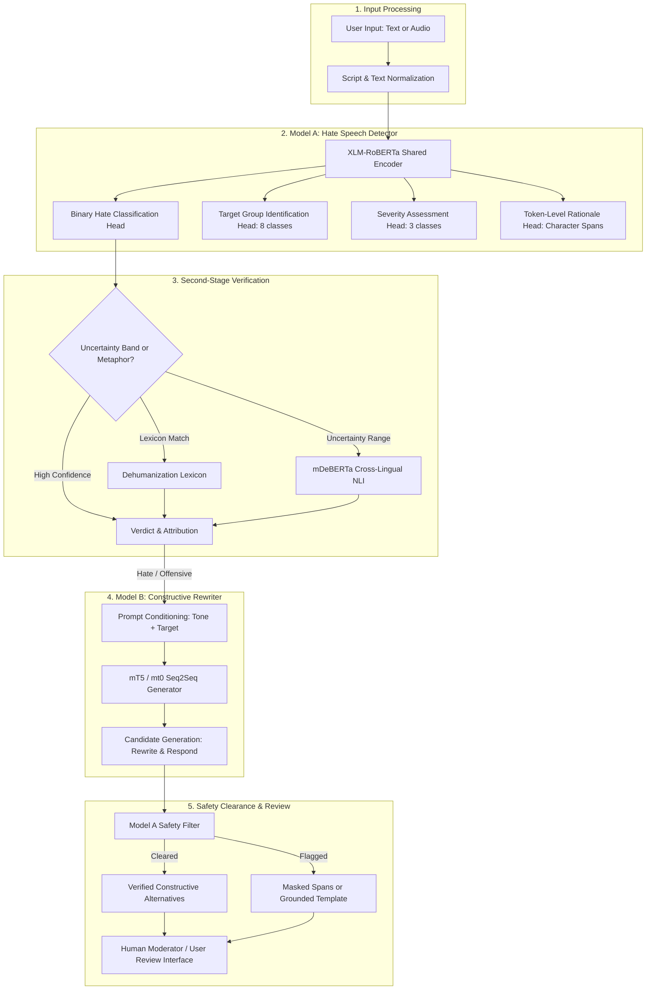

# Civitas AI
## Real-Time Multilingual Hate Speech Detection & Context-Aware Constructive Alternative Generation

**Repository:** [github.com/Kirethik/Hate-Speech-Detection](https://github.com/Kirethik/Hate-Speech-Detection)

Civitas AI is a research-backed, production-ready AI application that coordinates **two independently trained neural networks** to detect hate speech and generate constructive, tone-adapted non-hateful alternatives while preserving legitimate critique and intent.



---

## Key Highlights

- **Mandatory Two-Neural-Network Architecture**:
  - **Model A (Detector)**: `FacebookAI/xlm-roberta-base` fine-tuned for multi-task hate classification, severity rating, target community identification, and token rationale extraction.
  - **Model B (Generator)**: `google/mt5-small` / `bigscience/mt0-base` fine-tuned for conditional text rewriting across 5 configurable tones (`calm`, `factual`, `firm`, `empathetic`, `professional`).
- **Strict Decoupled Training**: Model A and Model B have completely independent Google Colab training notebooks, datasets, configurations, checkpoints, and export artifacts.
- **Safety Gating**: Model B outputs are never assumed safe; every generated candidate is re-scored by Model A. Unverified candidates are dropped in favor of masked rewrites or safe community templates.
- **Explainability**: Character-level rationale span highlighting, dehumanization metaphor detection, and NLI second-stage reasoning.
- **Human-in-the-Loop Moderation**: Complete moderation center for reviewing flagged content, approving/overriding verdicts, and editing alternatives.
- **Portable Artifacts & Transparent Demo Mode**: The application runs immediately in a calibrated **Demo Mode** with full UI, API, and analytics, and seamlessly switches to **Real Model Inference Mode** once exported artifacts are installed.

---

## Directory Structure

```text
Civitas-AI/
│
├── datasets/                                # Standardized dataset management
│   ├── README.md                            # Dataset guidelines & licenses
│   ├── manifest.json                        # Hashes & split row counts
│   ├── label_mapping.json                   # Canonical label indices
│   ├── prepare_datasets.py                  # Standardization & splitting script
│   ├── raw/                                 # Raw benchmarks (gitignored)
│   ├── processed/
│   │   ├── detector/                        # train.csv, validation.csv, test.csv
│   │   └── generator/                       # train.csv, validation.csv, test.csv
│   └── reports/                             # Statistical & distribution reports
│
├── training/                                # Exactly two Google Colab notebooks
│   ├── 01_train_hate_detector.ipynb         # Model A: XLM-RoBERTa training pipeline
│   └── 02_train_alternative_generator.ipynb # Model B: mT5 / mt0 training pipeline
│
├── model_artifacts/                         # Portable artifact destination folders
│   ├── hate_detector/                       # Put hate_detector_artifact.zip here
│   └── alternative_generator/               # Put alternative_generator_artifact.zip here
│
├── src/
│   └── models/                              # Stable interfaces & model loader
│       ├── interfaces.py                    # Contract dataclasses
│       ├── hate_detector.py                 # Model A detect_hate_speech()
│       ├── alternative_generator.py         # Model B generate_alternative()
│       └── model_loader.py                  # Lifecycle & status checks
│
├── evaluation/                              # Quantitative evaluation suite
│   ├── detector_evaluation.py               # Accuracy, Macro-F1, Confusion Matrix
│   └── generator_evaluation.py              # BLEU, ROUGE, Safety Clearance Rate
│
├── server/                                  # FastAPI backend & SQLite persistence
│   ├── app.py                               # REST & WebSocket endpoints
│   ├── models.py                            # Pydantic schemas
│   └── db.py                                # SQLite history, feedback & analytics
│
├── frontend/                                # React 19 + TypeScript + Vite Web UI
│   ├── src/
│   │   ├── components/                      # 7 modular views & input panels
│   │   ├── api/                             # API client & types
│   │   └── styles/                          # Design tokens
│
├── tests/                                   # Automated test suite (pytest)
│   ├── test_model_interfaces.py             # Contract verification
│   ├── test_api.py                          # FastAPI endpoint tests
│   └── test_preprocessing.py                # Schema & label map tests
│
├── docs/                                    # System documentation
│   ├── architecture.md                      # Pipeline design & data flow
│   ├── training_guide.md                    # Colab training instructions
│   ├── artifact_integration.md              # Artifact installation guide
│   ├── dataset_documentation.md             # Benchmark sources & leakage policy
│   └── evaluation_report_template.md        # Results template
│
├── scripts/
│   └── install_models.py                    # Automated artifact installer & checker
│
├── requirements.txt
└── README.md
```

---

## Application Pages

| Page | What it does |
|---|---|
| **Voice Studio** | Upload or record speech; hateful sentences are replaced (rewrite or counter-narrative) in the speaker's own voice, with every edit marked on the waveform |
| **Live Room** | Real-time multi-person voice room; hateful sentences are re-voiced before other participants hear them |
| **Overview** | System summary and model status |
| **Analyzer** | Analyze text, live mic or audio files: verdict, target group, explanation, highlighted spans, alternatives |
| **Rewrite** | Rewrite Studio with five tones and a safety check on every suggestion |
| **Moderation** | Human-in-the-loop review: approve or override AI verdicts |
| **Analytics** | Volume, detection rate, feedback and language breakdown |
| **Evaluation** | Accuracy, Macro-F1, recall, false-positive rate, per-language results, rewrite safety |
| **Settings** | Model and device status |

---

## Quickstart

### 0. Clone the Repository
```bash
git clone https://github.com/Kirethik/Hate-Speech-Detection.git
cd Hate-Speech-Detection
```

### 1. Backend Server
```bash
# Install dependencies
pip install -r requirements.txt

# Start FastAPI server (runs on http://127.0.0.1:8000)
python server/app.py
```

### 2. Frontend Application
```bash
cd frontend
npm install
npm run dev
# Opens at http://localhost:5173
```

---

## Google Colab Model Training

Training runs take place on Google Colab with GPU acceleration (T4 or higher):

1. **Model A (Detector)**:
   - Open [Google Colab](https://colab.research.google.com).
   - Upload `training/01_train_hate_detector.ipynb`.
   - Provide `datasets/processed/detector/{train,validation,test}.csv`.
   - Run all cells. Checkpoints back up to Google Drive automatically.
   - Download `hate_detector_artifact.zip`.

2. **Model B (Generator)**:
   - Upload `training/02_train_alternative_generator.ipynb`.
   - Provide `datasets/processed/generator/{train,validation,test}.csv`.
   - Run all cells.
   - Download `alternative_generator_artifact.zip`.

3. **Install Exported Artifacts**:
   - Place the two ZIP files in the project folder and run:
     ```bash
     python scripts/install_models.py --check
     ```
   - The application immediately switches from Demo Mode to Real Inference Mode without retraining or restarting.

---

## Running Automated Tests

```bash
# Run all unit and integration tests
python -m pytest tests/ -q
```
