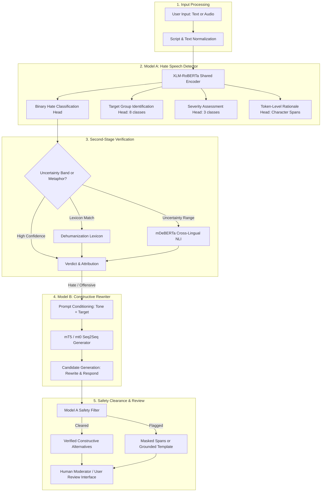

# Civitas AI — System Architecture

Civitas AI is a research-backed, production-grade system designed for real-time multilingual hate speech detection and context-aware constructive alternative generation.

## Core Architectural Principles

1. **Two Distinct Neural Networks**:
   - **Model A (Detector)**: `FacebookAI/xlm-roberta-base` fine-tuned for sequence and token classification across 8 languages.
   - **Model B (Generator)**: `google/mt5-small` / `bigscience/mt0-base` fine-tuned for conditional text rewriting with tone control.
2. **Safety Gating**:
   - Model B outputs are never automatically assumed to be safe. Every candidate generated is re-scored by Model A. Any candidate that repeats abusive vocabulary or scores above the safety threshold is dropped.
3. **Decoupled Lifecycle**:
   - Model A and Model B have completely separate training notebooks, configurations, tokenizers, checkpoints, and export artifacts.
   - Application development operates independently of training via a dedicated, transparent Demo Mode.
